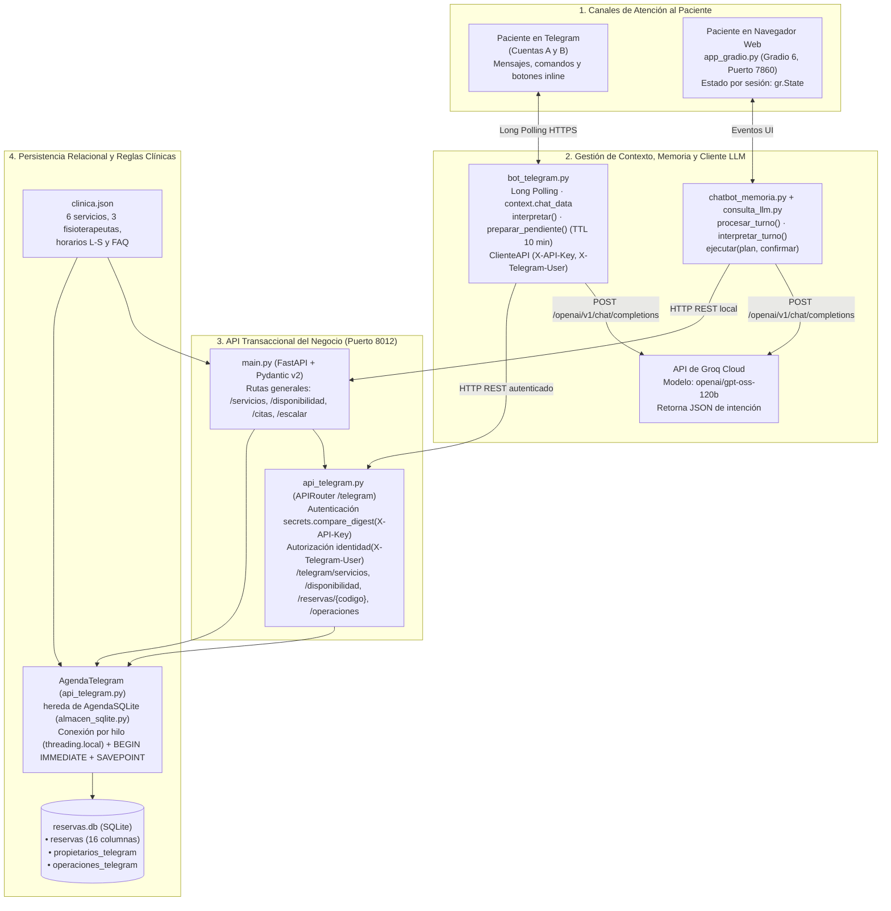

# Bitácora Técnica Consolidada — Entrega Final (VLFisioterapia)

- **Proyecto:** VLFisioterapia · Centro Integral de Fisioterapia y Rehabilitación
- **Curso:** Creación de Chatbots con Inteligencia Artificial (Electiva 2) · Periodo EAM 2026-II
- **Equipo:** `Equipo_Sheen_castaneda_vargas`
- **Integrantes y roles:**
  - **Victor Sheen Arias Zuleta** — Cabecilla / Arquitecto
  - **Valentín Castañeda Marín** — Observadora / QA
  - **Samuel Rojas Vargas** — Mano Derecha / Backend Lead
- **Fecha de corte documental:** 2026-11-22 (Tercer Corte — Entrega Final con Canal Telegram)

---

## 1. Problema, usuarios y alcance

### 1.1 Problema del negocio y usuarios objetivo
En un centro de fisioterapia y rehabilitación física (**VLFisioterapia**, ubicado ficticiamente en Armenia, Quindío), la recepción manual de solicitudes de valoración y sesiones terapéuticas genera demoras de atención fuera del horario de oficina, pérdida de turnos cuando un paciente cancela sin liberar la agenda a tiempo, y posibles cruces de horario cuando varios especialistas atienden distintos tratamientos en paralelo con duraciones variables (45 o 60 minutos).

Además, operar únicamente mediante una página web local limitaba el acceso desde dispositivos móviles y carecía de un mecanismo de identidad por cuenta que impidiera que un paciente consultara, modificara o cancelara por error (o malicia) la cita de otra persona.

Los **usuarios objetivo** son:
1. **Pacientes de la clínica:** personas que desean conocer el catálogo de tratamientos, tarifas en pesos colombianos (COP), horarios de atención y turnos disponibles por especialista, o bien agendar, consultar, reprogramar y cancelar citas médicas expresándose en lenguaje natural a través de **Telegram** (canal principal de producción móvil/escritorio) o **Gradio 6** (interfaz web de laboratorio).
2. **Personal administrativo y fisioterapeutas (`mariana`, `carlos`, `valeria`):** responsables de que ninguna cita se registre fuera del horario laboral, que se respete la duración real de cada terapia, que no se solapen dos pacientes con el mismo profesional en el mismo intervalo, y que toda modificación o cancelación desde Telegram valide estrictamente la propiedad de la reserva y su estado actual.

### 1.2 Alcance funcional y límites de la versión final
- **Dentro del alcance (funciones implementadas en la versión final):**
  - **Tres canales evolutivos integrados sobre el mismo backend:** puente histórico de Flowise (`POST /chat`, primer corte), interfaz web interactiva en Gradio 6 ([`app_gradio.py`](../app_gradio.py), segundo corte) y adaptador conversacional en **Telegram** con *long polling* y botones inline ([`bot_telegram.py`](../bot_telegram.py) + [`api_telegram.py`](../api_telegram.py), tercer corte).
  - **Catálogo clínico completo ([`clinica.json`](../clinica.json)):** consulta de los 6 tratamientos fisioterapéuticos con precios en COP y duraciones diferenciadas:
    - `evaluacion` — Valoración Inicial y Diagnóstico Funcional (60 min, `$80.000 COP`).
    - `deportiva` — Fisioterapia Deportiva y Readaptación (45 min, `$70.000 COP`).
    - `traumatologica` — Rehabilitación Traumatológica y Postquirúrgica (45 min, `$65.000 COP`).
    - `puncion_seca` — Terapia Manual y Punción Seca (45 min, `$75.000 COP`).
    - `postural` — Reeducación Postural Global (RPG) y Columna (45 min, `$60.000 COP`).
    - `neurologica` — Rehabilitación Neurológica Integral (60 min, `$85.000 COP`).
  - **Cálculo determinista de disponibilidad por especialista:** consulta de horarios libres en pasos de 30 minutos (`GET /disponibilidad` y `GET /telegram/disponibilidad`) para una fecha y servicio dados, filtrando por fisioterapeuta (`mariana`, `carlos`, `valeria`) o calculando la unión de cupos de los profesionales habilitados para ese tratamiento.
  - **Conversación multi-turno con contexto aislado por cuenta:** acumulación de entidades (`cliente`, `servicio`, `fecha`, `hora`, `codigo`, `fisioterapeuta`) a lo largo de varios turnos, manteniendo historiales y propuestas pendientes independientes por cada cuenta de Telegram (`context.chat_data`) o pestaña de Gradio (`gr.State`).
  - **Confirmación explícita mediante botones inline con vigencia (TTL):** ninguna operación de escritura (`crear`, `modificar`, `cancelar`) es ejecutada directamente por el modelo de lenguaje. En Telegram, el bot presenta un resumen con identificador único (`solicitud_id`), huella del estado actual (`referencia`), vigencia de 10 minutos y botones **Confirmar** y **Descartar**.
  - **Control estricto de propiedad por cuenta de Telegram:** cada cita creada desde Telegram registra su dueño (`usuario_id`) en la tabla `propietarios_telegram`. Cualquier intento de consultar, modificar o cancelar una reserva perteneciente a otra cuenta (o una cita histórica creada desde Gradio/API) se rechaza de forma segura con `HTTP 404` (`"Reserva no disponible para este usuario"`).
  - **Idempotencia, bloqueo optimista (SHA-256) y recuperación de estado incierto:** cada escritura autorizada se procesa en `POST /telegram/operaciones` dentro de una transacción `BEGIN IMMEDIATE` con `SAVEPOINT cambio_reserva`, verificando la huella SHA-256 de la reserva antes de modificar o cancelar (`HTTP 409` si cambió) y guardando el recibo en `operaciones_telegram`. Si se pierde la respuesta de red (`simular_respuesta_perdida.py`), el bot marca la solicitud como `incierta` y permite recuperar el recibo exacto mediante `/estado` o `/reintentar` sin duplicar citas.
- **Fuera del alcance (límites clínicos y de seguridad estrictos):**
  - El asistente **no realiza diagnósticos médicos**, no interpreta exámenes de imagen ni **prescribe medicamentos**. Ante consultas sobre fármacos o sospecha de lesiones agudas (p. ej., desgarros), informa explícitamente esta restricción y deriva a valoración médica presencial o recepción humana (`+57 300 987 6543` / WhatsApp `+57 311 234 5678`).
  - No atiende urgencias médicas hospitalarias vitales ni fracturas abiertas.
  - Rechaza preguntas ajenas al dominio de la fisioterapia (`fuera_de_alcance`) y bloquea intentos de inyección de prompts o solicitudes de extracción de claves (`CHATBOT_API_KEY`, `TELEGRAM_BOT_TOKEN`, `GROQ_API_KEY`) o listados de reservas de otros pacientes.

---

## 2. Arquitectura y archivos

### 2.1 Diseño en capas desacopladas y recorrido de una solicitud
El sistema separa estrictamente los canales de interacción con el paciente (Telegram y Gradio), el cliente de interpretación con el modelo de lenguaje (Groq), la autoridad transaccional del negocio (FastAPI) y el motor de almacenamiento relacional (SQLite):



#### Recorrido paso a paso de una solicitud desde Telegram hasta SQLite
1. **Recepción en Telegram (`bot_telegram.py`):** El usuario envía un mensaje en un chat privado (`filters.ChatType.PRIVATE`). `recibir_texto()` verifica que no exista una operación en estado `ejecutando` o `incierta` pendiente de comprobar con `/estado`.
2. **Interpretación con Groq (`interpretar()` en `bot_telegram.py`):** Se concatena el mensaje al historial aislado del chat (`context.chat_data["historial"]`, que incluye la fecha actual en `America/Bogota`) y se envía a Groq (`openai/gpt-oss-120b`) mediante `peticion_json()` de [`consulta_llm.py`](../consulta_llm.py). El modelo responde únicamente con un JSON de 7 campos: `accion`, `cliente`, `servicio`, `fecha`, `hora`, `codigo`, `fisioterapeuta`.
3. **Clasificación y verificación de requisitos:**
   - Si la consulta es sobre horarios generales de atención, síntomas sin tratamiento o solicitud de diagnóstico/medicamentos, `respuesta_orientacion_especial()` responde con la información oficial de [`clinica.json`](../clinica.json) o con los límites clínicos y datos de recepción humana sin tocar la base de datos.
   - Si `accion == "fuera_de_alcance"`, informa las capacidades del asistente sin llamar a la API.
   - Si faltan campos obligatorios según `REQUERIDOS`, solicita únicamente los datos pendientes.
   - Si es una **lectura** (`servicios`, `disponibilidad`, `consultar`), `ClienteAPI.leer()` invoca `GET /telegram/servicios`, `GET /telegram/disponibilidad` o `GET /telegram/reservas/{codigo}` enviando las cabeceras `X-API-Key` y `X-Telegram-User`.
4. **Presentación del resumen y botones inline (escrituras):**
   - Si `accion` es `modificar` o `cancelar`, el bot consulta primero `GET /telegram/reservas/{codigo}` para verificar que la cita pertenezca al usuario y obtener sus datos actuales junto con su huella SHA-256 (`referencia`).
   - `preparar_pendiente()` genera un `solicitud_id` aleatorio (`uuid4().hex`), fija una vigencia de 10 minutos (`monotonic() + 600`), guarda la propuesta en `context.chat_data["pendiente"]` y envía al chat el resumen con los botones inline **Confirmar** (`confirmar:<solicitud_id>`) y **Descartar** (`descartar:<solicitud_id>`).
5. **Validación del botón y ejecución atómica (`atender_decision` → `POST /telegram/operaciones`):**
   - Al pulsar **Confirmar**, `motivo_rechazo()` comprueba en el bot que exista propuesta pendiente, que coincidan `chat_id`, `usuario_id` y `solicitud_id`, que el estado sea `por_confirmar` y que no hayan transcurrido más de 10 minutos.
   - `ejecutar_confirmada()` envía `POST /telegram/operaciones` a FastAPI con `{solicitud_id, accion, datos, referencia, confirmada: True}`.
   - En FastAPI ([`api_telegram.py`](../api_telegram.py)), `autenticar()` valida `X-API-Key`, `identidad()` extrae `X-Telegram-User` y `AgendaTelegram.operar()` abre una transacción `BEGIN IMMEDIATE`:
     1. Verifica en `operaciones_telegram` si el `solicitud_id` ya fue procesado (si existe con la misma huella, devuelve el recibo guardado sin repetir la escritura; si tiene datos distintos, devuelve `409`).
     2. Abre `SAVEPOINT cambio_reserva`.
     3. En `modificar` o `cancelar`, comprueba propiedad en `propietarios_telegram` (`_propia`) y compara `huella(actual) == solicitud.referencia` (bloqueo optimista; si difiere, lanza `ConflictoReserva` → `409`).
     4. Ejecuta `self.crear()`, `self.modificar()` o `self.cancelar()` reutilizando la misma conexión del hilo (`self._hilo.conexion`), validando horarios y cruces por fisioterapeuta en la tabla `reservas`. En `crear`, inserta además el vínculo `(codigo, usuario_id)` en `propietarios_telegram`.
     5. Si ocurre un error de negocio (`404`, `409`, `422`), ejecuta `ROLLBACK TO cambio_reserva`, libera el savepoint y registra el resultado en `operaciones_telegram`.
     6. Confirma la transacción (`COMMIT`) y retorna el recibo JSON con el código `VF-...` y la nueva `referencia`.

### 2.2 Responsabilidad de cada archivo del repositorio

| Archivo | Estado en 3.er Corte | Funciones / Clases clave | Responsabilidad técnica |
|---|---|---|---|
| [`api_telegram.py`](../api_telegram.py) | **Nuevo (3.er corte)** | `huella()`, `DatosReserva`, `Operacion`, `AgendaTelegram`, `crear_router()` | Extiende `AgendaSQLite` con las tablas `propietarios_telegram` y `operaciones_telegram`, conexión compartida por hilo (`threading.local`), transacciones atómicas con `SAVEPOINT cambio_reserva`, bloqueo optimista SHA-256 y sub-router `/telegram` protegido por `X-API-Key` y `X-Telegram-User`. |
| [`bot_telegram.py`](../bot_telegram.py) | **Nuevo (3.er corte)** | `interpretar()`, `preparar_pendiente()`, `motivo_rechazo()`, `ClienteAPI`, `recibir_texto()`, `atender_decision()`, `consultar_estado()`, `reintentar()` | Adaptador conversacional de Telegram con *long polling*, aislamiento por chat en `context.chat_data`, comandos (`/start`, `/help`, `/reserva`, `/estado`, `/reintentar`, `/descartar`, `/reset`), botones inline con TTL de 10 minutos, manejo de estado incierto y formateo en pesos COP. |
| [`simular_respuesta_perdida.py`](../simular_respuesta_perdida.py) | **Nuevo (3.er corte)** | `main()`, `ejecutar_con_perdida()` | Envuelve `ClienteAPI.ejecutar` para interceptar la primera escritura exitosa (después de persistir en SQLite) y lanzar `TimeoutError`, permitiendo probar de forma determinista el escenario T24 y la recuperación con `/estado`. |
| [`test_telegram.py`](../test_telegram.py) | **Nuevo (3.er corte)** | `test_autenticacion_y_seguridad()`, `test_catalogo_y_disponibilidad()`, `test_ciclo_operaciones_propiedad_y_bloqueo_ajeno()`, `test_idempotencia_y_recibos()`, `test_concurrencia_t22()`, `test_logica_bot_telegram_unitario()` | Suite automatizada del canal Telegram que verifica autenticación (`401`/`503`/`422`), propiedad de reservas (`404`), bloqueo optimista (`409`), idempotencia, concurrencia multihilo (T22), vigencia de botones y respuesta perdida (T24) sobre SQLite temporal. |
| [`main.py`](../main.py) | **Modificado (3.er corte)** | `agenda = AgendaTelegram.desde_negocio(...)`, `app.include_router(crear_router(...))`, endpoints REST y `/chat` | Servidor FastAPI principal (puerto `8012`). Unifica en una sola instancia de `AgendaTelegram` las rutas nativas (`/servicios`, `/disponibilidad`, `/citas`, `/escalar`), las rutas de compatibilidad (`/api/*`, `/chat`) y el router protegido `/telegram`. |
| [`almacen_sqlite.py`](../almacen_sqlite.py) | **Reutilizado (2.º corte)** | `AgendaSQLite`, `desde_negocio()`, `conexion()`, `validar_intervalo()`, `ocupado()`, `disponibilidad()`, `crear()`, `modificar()`, `cancelar()`, `consultar()` | Motor de persistencia en SQLite (`reservas.db`), creación de la tabla `reservas` (16 columnas e índices), transacciones `BEGIN IMMEDIATE`, validación de horarios semanales y comprobación de cruces por `fisioterapeuta_asignado`. |
| [`consulta_llm.py`](../consulta_llm.py) | **Reutilizado (2.º corte)** | `cargar_env()`, `peticion_json()`, `extraer_json()`, `normalizar_servicio()`, `interpretar()`, `ejecutar()` | Carga variables desde `.env`, realiza peticiones HTTP a Groq (`urllib.request`) con prioridad IPv4, normaliza nombres coloquiales de tratamientos (`MAPA_SERVICIOS`) y ejecuta operaciones REST desde consola/Gradio. |
| [`chatbot_memoria.py`](../chatbot_memoria.py) | **Reutilizado (2.º corte)** | `nuevo_historial()`, `interpretar_turno()`, `procesar_turno()` | Gestiona el historial multi-turno `[system, user, assistant]` para el canal web de Gradio y consola interactiva. |
| [`app_gradio.py`](../app_gradio.py) | **Reutilizado (2.º corte)** | `nuevo_estado()`, `enviar()`, `confirmar()`, `descartar()`, `reiniciar()`, `crear_interfaz()` | Interfaz web en Gradio 6 (puerto `7860`) con estado aislado por pestaña (`gr.State`) y botones de confirmación/descarte/reinicio. |
| [`preparar_datos_prueba.py`](../preparar_datos_prueba.py) | **Modificado (3.er corte)** | `siguientes_dias_habiles()`, `preparar_datos(reiniciar)` | Siembra o reinicia (`--reiniciar`) las 5 reservas ficticias en fechas hábiles futuras (`Paciente Demo 1` a `Paciente Demo 5`) y vacía `propietarios_telegram` y `operaciones_telegram`. |
| [`probar_fisioterapia.py`](../probar_fisioterapia.py) | **Reutilizado (2.º corte)** | `ejecutar_pruebas()` | Suite determinista del backend FastAPI y `AgendaSQLite` (catálogos, disponibilidad, validaciones `422`, concurrencia `[201, 409]`, cruces por profesional, adyacencia exacta, reprogramación, cancelación y fallo `503`). |
| [`test_integracion_completa.py`](../test_integracion_completa.py) | **Reutilizado (2.º corte)** | `probar_todo()` | Prueba de integración extremo a extremo con llamada real a Groq y memoria multi-turno. |
| [`clinica.json`](../clinica.json) | **Reutilizado (1.er corte)** | Catálogo JSON | Configuración estática del negocio: 6 servicios, 3 fisioterapeutas, horarios por día (`0` a `5`), `paso_minutos: 30`, `zona_horaria: "America/Bogota"`, convenios, FAQ y derivación humana. |
| [`reservas.db`](../reservas.db) | **Actualizado (3.er corte)** | Tablas `reservas`, `propietarios_telegram`, `operaciones_telegram` | Base de datos SQLite entregada con 5 reservas semilla en días hábiles futuros y sin registros residuales de pruebas manuales. |
| [`requirements.txt`](../requirements.txt) | **Consolidado (3.er corte)** | Lista única de paquetes | Único archivo de dependencias del proyecto (integra FastAPI, Uvicorn, Httpx, Tzdata, Pydantic v2, Gradio 6, `python-telegram-bot` y `pysqlite3-binary` para Linux). |

---

## 3. Contexto, memoria y estado

### 3.1 Consumo del modelo de lenguaje (Groq) e inyección de contexto temporal
Tanto [`consulta_llm.py`](../consulta_llm.py) / [`chatbot_memoria.py`](../chatbot_memoria.py) como [`bot_telegram.py`](../bot_telegram.py) consumen directamente el endpoint compatible con OpenAI de Groq Cloud usando `urllib.request`:
- **Endpoint (`GROQ_URL`):** `https://api.groq.com/openai/v1/chat/completions` (`POST`).
- **Modelo (`GROQ_MODEL`):** `openai/gpt-oss-120b`, autenticado mediante cabecera `Authorization: Bearer <GROQ_API_KEY>` leída desde `.env`.
- **Inyección de la fecha actual en zona horaria local:** En [`bot_telegram.py`](../bot_telegram.py), `nuevo_historial()` calcula la fecha actual en Armenia, Quindío (`ZoneInfo("America/Bogota")`) e inyecta al final del mensaje `system`:
  ```text
  Fecha actual en Armenia, Quindío (America/Bogota): 2026-11-21.
  ```
- **Estructura del historial en memoria (`messages`):**
  Cada turno agrega un par de mensajes a la lista `historial` del chat:
  1. `{"role": "user", "content": pregunta}`
  2. `{"role": "assistant", "content": json.dumps({"plan": plan, "resultado": resultado}, ensure_ascii=False)}`
  Al serializar el `plan` extraído dentro del mensaje `assistant`, en el siguiente turno el modelo de lenguaje observa qué campos (`cliente`, `servicio`, `fecha`, `hora`, `codigo`, `fisioterapeuta`) ya fueron entregados por el paciente y los combina con los datos nuevos sin pedirlos dos veces.

### 3.2 Separación del historial y propuestas pendientes entre cuentas
Verificado directamente en el código fuente:
1. **En Telegram ([`bot_telegram.py`](../bot_telegram.py)):**
   - Todos los manejadores se registran con el filtro `filters.ChatType.PRIVATE` (`registrar_handlers()`).
   - `python-telegram-bot` mantiene un diccionario `context.chat_data` independiente por cada `chat_id` (que en chats privados corresponde 1 a 1 con el `usuario_id` de la cuenta de Telegram).
   - Dentro de `context.chat_data` de cada cuenta se almacenan cuatro claves aisladas:
     - `"historial"`: lista de mensajes `[system, user, assistant]` exclusiva de esa conversación.
     - `"pendiente"`: diccionario con la propuesta activa (`solicitud_id`, `chat_id`, `usuario_id`, `plan`, `referencia`, `estado`, `vence_en`, `mensaje_id`) o `None`.
     - `"codigos"`: conjunto (`set`) de códigos `VF-...` creados o consultados con éxito en esa sesión de chat, usado para desambiguar referencias implícitas (*"modifica mi cita"* cuando solo hay un código conocido vs. múltiples códigos en T10).
     - `"ultima_solicitud"`: último `solicitud_id` enviado a ejecución en ese chat, utilizado por `/estado` cuando el usuario no pasa argumento.
   - Gracias a este aislamiento, cuando la **Cuenta A (`<ID_CUENTA_A>`, iPhone)** y la **Cuenta B (`<ID_CUENTA_B>`, Android)** conversan con el bot en el mismo minuto (`11:12`), cada llamada a `interpretar(pregunta, historial, ...)` envía únicamente el `context.chat_data["historial"]` de esa cuenta, y las propuestas en `context.chat_data["pendiente"]` nunca se cruzan (verificado con capturas reales en el caso **T12**: [`../evidencias/T12_cuentaA_flujo.png`](../evidencias/T12_cuentaA_flujo.png), [`../evidencias/T12_cuentaB_acceso_ajeno.png`](../evidencias/T12_cuentaB_acceso_ajeno.png) y [`../evidencias/T12_cuentaB_crea.png`](../evidencias/T12_cuentaB_crea.png)).
2. **En Gradio ([`app_gradio.py`](../app_gradio.py)):**
   - Cada pestaña del navegador instancia su propio estado mediante `gr.State(value=nuevo_estado)` con las claves `"historial"`, `"pantalla"` y `"pendiente"`.

### 3.3 Qué ocurre al reiniciar el chat (`/reset`) y al reiniciar los procesos (memoria vs. SQLite)

| Evento | Qué cambia / Qué se pierde (Memoria volátil) | Qué permanece intacto (Persistencia SQLite `reservas.db`) |
|---|---|---|
| **Comando `/reset` en Telegram** (`reiniciar()` en `bot_telegram.py`, caso **T13** en [`../evidencias/T13_reset.png`](../evidencias/T13_reset.png)) | Si no hay una operación `ejecutando` o `incierta`, retira los botones de la propuesta pendiente en ese chat, ejecuta `context.chat_data.clear()` y crea un `nuevo_historial()` con solo el mensaje `system`. **El estado de otras cuentas de Telegram no se toca.** | Todas las filas de `reservas`, `propietarios_telegram` y `operaciones_telegram` en `reservas.db` siguen intactas. El usuario puede consultar inmediatamente sus citas previas con `/reserva CODIGO` (p. ej. `/reserva VF-F3D3183CA4` en [`../evidencias/T13_reset.png`](../evidencias/T13_reset.png)). |
| **Botón *Reiniciar conversación* en Gradio** (`reiniciar()` en `app_gradio.py`) | Restablece el `gr.State` de esa pestaña a `nuevo_estado()`. Las demás pestañas continúan su conversación normal. | Todas las reservas confirmadas en `reservas.db` se conservan sin cambios. |
| **Detener y reiniciar el proceso de Python (`bot_telegram.py` / `uvicorn main:app`)** (caso **T14** en [`../evidencias/T14_reinicio.png`](../evidencias/T14_reinicio.png) y [`../evidencias/T14_reinicio_db.txt`](../evidencias/T14_reinicio_db.txt)) | Se vacía la memoria RAM del proceso `bot_telegram.py`: se pierden los historiales de conversación (`context.chat_data["historial"]`) y las propuestas no confirmadas (`por_confirmar`). Si había botones viejos visibles en la app de Telegram, al pulsarlos tras el reinicio el bot los rechaza (`"No hay una solicitud pendiente en esta conversación."`). | **Persiste el 100 % del estado transaccional en `reservas.db`:**<br>1. Tabla `reservas`: todas las citas activas y canceladas con sus 16 columnas.<br>2. Tabla `propietarios_telegram`: cada usuario conserva la propiedad de sus códigos `VF-...` (`/reserva VF-F3D3183CA4` sigue funcionando tras reiniciar el bot a las `11:04:16`).<br>3. Tabla `operaciones_telegram`: todos los recibos y códigos HTTP por `solicitud_id` (`/estado REFERENCIA` sigue recuperando recibos tras reiniciar). |

---

## 4. Operaciones y validaciones

### 4.1 Resumen previo, confirmación por botones inline, vigencia (TTL) y descarte
En [`bot_telegram.py`](../bot_telegram.py), toda intención de escritura (`crear`, `modificar`, `cancelar`) con datos completos pasa por una barrera de confirmación antes de invocar a FastAPI:
1. **Generación de propuesta (`preparar_pendiente`):**
   ```python
   def preparar_pendiente(plan, chat_id, usuario_id, referencia=""):
       return {
           "solicitud_id": uuid4().hex,
           "chat_id": chat_id,
           "usuario_id": usuario_id,
           "plan": deepcopy(plan),
           "referencia": referencia,
           "estado": "por_confirmar",
           "vence_en": monotonic() + 600,  # 10 minutos de vigencia
       }
   ```
2. **Validación estricta al pulsar un botón (`motivo_rechazo`):**
   Cuando llega un `CallbackQuery` con `confirmar:<id>` o `descartar:<id>`, `motivo_rechazo(pendiente, solicitud_id, chat_id, usuario_id, monotonic())` verifica cinco condiciones en orden:
   - Que exista `pendiente` en `context.chat_data` (`"No hay una solicitud pendiente en esta conversación."`).
   - Que `chat_id` y `usuario_id` coincidan con quien creó la propuesta (`"Esta confirmación no corresponde a tu conversación."`).
   - Que `pendiente["solicitud_id"] == solicitud_id` (`"Ese resumen ya no es el vigente."` — rechaza botones de propuestas anteriores reemplazadas, como se verifica en vivo en **T23**: [`../evidencias/T23_reemplazo_y_boton_antiguo_1.png`](../evidencias/T23_reemplazo_y_boton_antiguo_1.png) y [`../evidencias/T23_boton_antiguo_2.png`](../evidencias/T23_boton_antiguo_2.png)).
   - Que `pendiente["estado"] == "por_confirmar"` (`"La solicitud ya se está procesando o tiene un resultado por verificar."` — bloquea dobles clics concurrentes).
   - Que `ahora < pendiente["vence_en"]` (`"El resumen venció (límite de 10 minutos). Prepara y revisa una nueva solicitud."`).
3. **Descarte (botón `Descartar` o comando `/descartar`):** Retira el teclado inline del mensaje, elimina `context.chat_data["pendiente"]` y responde `"Propuesta descartada. No se modificó tu agenda."` sin enviar ninguna petición HTTP a FastAPI (verificado en [`../evidencias/T23_descartar_3.png`](../evidencias/T23_descartar_3.png)).

### 4.2 Endpoints de FastAPI (`main.py` y router `/telegram` en `api_telegram.py`)

#### Rutas protegidas del canal Telegram (`/telegram/*`)
Todas las rutas del router creado por `crear_router(agenda, clave)` exigen la cabecera `X-API-Key` validada con `secrets.compare_digest(clave_limpia, x_api_key)`. Si `CHATBOT_API_KEY` no está configurada al iniciar FastAPI, el router responde `HTTP 503` (*"Canal Telegram deshabilitado en el servidor"*). Si la clave no coincide, responde `HTTP 401`. Las rutas de reservas y operaciones exigen además `X-Telegram-User` (entero positivo `> 0`, o `HTTP 422`).

| Método y Ruta | Cabeceras requeridas | Código éxito | Operación en `AgendaTelegram` y propósito |
|---|---|:---:|---|
| `GET /telegram/servicios` | `X-API-Key` | `200` | Retorna el catálogo de 6 servicios con `nombre`, `precio_cop`, `duracion_minutos` y `descripcion`. |
| `GET /telegram/disponibilidad` | `X-API-Key` | `200` | Query: `fecha`, `servicio`, `fisioterapeuta` (opc.). Calcula `horarios_disponibles` descontando citas activas. |
| `GET /telegram/reservas/{codigo}` | `X-API-Key`, `X-Telegram-User` | `200` | Llama a `agenda.consultar_propia(codigo, usuario_id)`. Verifica propiedad en `propietarios_telegram` (`404` si es ajena o legacy) y devuelve `{"reserva": ..., "referencia": huella(reserva)}`. |
| `POST /telegram/operaciones` | `X-API-Key`, `X-Telegram-User` | `201` / `200` | Cuerpo `Operacion` (`solicitud_id`, `accion`, `datos`, `referencia`, `confirmada: True`). Ejecuta creación (`201`), modificación (`200`) o cancelación (`200`) de forma atómica e idempotente. |
| `GET /telegram/operaciones/{solicitud_id}` | `X-API-Key`, `X-Telegram-User` | `200` | Llama a `agenda.consultar_operacion(solicitud_id, usuario_id)`. Recupera el recibo persistido (`estado_http` y `resultado`) para `/estado`. |

*(Adicionalmente, `main.py` expone las rutas generales `GET /clinica`, `GET /servicios`, `GET /fisioterapeutas`, `GET /faq`, `GET /disponibilidad`, `POST /citas`, `GET /citas/{codigo}`, `PATCH /citas/{codigo}/reprogramar`, `DELETE /citas/{codigo}?confirmado=true`, `POST /escalar` y las rutas de compatibilidad `/api/*` y `POST /chat`).*

### 4.3 Esquema relacional en SQLite (`reservas.db`) y transacciones con `SAVEPOINT`
La base de datos `reservas.db` contiene tres tablas creadas automáticamente al inicializar `AgendaTelegram`:

```sql
-- 1. Tabla principal del negocio (16 columnas, almacen_sqlite.py)
CREATE TABLE IF NOT EXISTS reservas (
    codigo TEXT PRIMARY KEY,
    cliente TEXT NOT NULL,
    servicio TEXT NOT NULL,
    fecha TEXT NOT NULL,
    hora TEXT NOT NULL,
    duracion_minutos INTEGER NOT NULL CHECK (duracion_minutos > 0),
    estado TEXT NOT NULL CHECK (estado IN ('activa', 'cancelada', 'reprogramada')),
    fisioterapeuta TEXT,
    fisioterapeuta_asignado TEXT NOT NULL DEFAULT '',
    telefono TEXT,
    motivo_consulta TEXT,
    precio_cop INTEGER NOT NULL DEFAULT 0,
    creada_en TEXT NOT NULL DEFAULT '',
    cancelada_en TEXT,
    reprogramada_en TEXT,
    historial_reprogramaciones TEXT NOT NULL DEFAULT '[]'
);

-- 2. Tabla de propiedad por cuenta de Telegram (api_telegram.py)
CREATE TABLE IF NOT EXISTS propietarios_telegram (
    codigo TEXT PRIMARY KEY,
    usuario_id INTEGER NOT NULL
);

-- 3. Tabla de idempotencia y recibos de operaciones (api_telegram.py)
CREATE TABLE IF NOT EXISTS operaciones_telegram (
    solicitud_id TEXT PRIMARY KEY,
    usuario_id INTEGER NOT NULL,
    huella TEXT NOT NULL,
    estado_http INTEGER NOT NULL,
    respuesta TEXT NOT NULL
);
```

### 4.4 Reglas de disponibilidad, propiedad, bloqueo optimista (SHA-256), idempotencia y errores
1. **Horarios, duraciones y cruces por fisioterapeuta (`almacen_sqlite.py`):**
   - Horarios de atención (`clinica.json`): lunes a viernes (`"0"` a `"4"`) de `07:00` a `19:00`; sábados (`"5"`) de `08:00` a `14:00`; domingos (`"6"`) cerrado. Grilla de `30` minutos.
   - Especialidades por profesional:
     - **Mariana (`mariana`):** `evaluacion`, `deportiva`, `traumatologica`, `puncion_seca`.
     - **Carlos (`carlos`):** `evaluacion`, `neurologica`, `puncion_seca`, `postural`.
     - **Valeria (`valeria`):** `evaluacion`, `postural`, `traumatologica`, `deportiva`.
   - En `AgendaSQLite.ocupado()`, se consultan las citas con `estado='activa'` de ese `fisioterapeuta_asignado` en esa fecha y se comprueba la intersección de intervalos semiabiertos $[inicio, inicio + duracion)$:
     ```python
     any(
         inicio < minutos(fila["hora"]) + fila["duracion_minutos"]
         and inicio + duracion > minutos(fila["hora"])
         for fila in filas
     )
     ```
   - Esto rechaza solapamientos parciales o totales del mismo profesional (`HTTP 409`, como el cruce real entre la reserva `VF-571AF9B513` de la Cuenta B y la solicitud de `"Juanita"` de la Cuenta A con `valeria` a las `11:00` en **T21**: [`../evidencias/T12_cuentaB_crea.png`](../evidencias/T12_cuentaB_crea.png) y [`../evidencias/T21_cruce_rechazado.png`](../evidencias/T21_cruce_rechazado.png)), permite citas simultáneas con distintos fisioterapeutas (`HTTP 201`) y admite turnos contiguos exactos (p. ej. una cita que termina a las `11:00` y otra que inicia a las `11:00`).
2. **Control de propiedad (`_propia` en `api_telegram.py`):**
   ```python
   propietario = con.execute(
       "SELECT usuario_id FROM propietarios_telegram WHERE UPPER(codigo)=?", (cod,)
   ).fetchone()
   if propietario is None or propietario["usuario_id"] != usuario_id:
       raise ReservaNoEncontrada("Reserva no disponible para este usuario")
   ```
   Si otro usuario de Telegram intenta consultar, modificar o cancelar un código ajeno (p. ej. cuando la Cuenta B ejecuta `/reserva VF-84FAC21E56` perteneciente a la Cuenta A en **T12**: [`../evidencias/T12_cuentaB_acceso_ajeno.png`](../evidencias/T12_cuentaB_acceso_ajeno.png)) o un código creado desde Gradio/semilla que no tiene fila en `propietarios_telegram`, recibe `HTTP 404` sin revelar si el código existe en la clínica.
3. **Bloqueo optimista con huella SHA-256 (`huella` y `referencia`):**
   Al preparar un resumen de modificación (**T19**: [`../evidencias/T19_modificar_resumen.png`](../evidencias/T19_modificar_resumen.png) y [`../evidencias/T19_modificar_resultado.png`](../evidencias/T19_modificar_resultado.png)) o cancelación (**T20**: [`../evidencias/T20_cancelar_resumen.png`](../evidencias/T20_cancelar_resumen.png) y [`../evidencias/T20_cancelar_resultado.png`](../evidencias/T20_cancelar_resultado.png)), el bot obtiene `referencia = huella(reserva)` (hash SHA-256 del JSON canónico de la fila). Al confirmar, `AgendaTelegram.operar()` verifica `huella(actual) == solicitud.referencia`. Si la cita fue alterada por otro canal mientras el usuario miraba el resumen, se lanza `ConflictoReserva` (`HTTP 409`: *"La reserva cambió. Consúltala y prepara otro resumen"*).
4. **Transacción compuesta con `BEGIN IMMEDIATE` y `SAVEPOINT cambio_reserva`:**
   `AgendaTelegram` comparte la conexión activa del hilo mediante `self._hilo = local()`. Dentro de `BEGIN IMMEDIATE`, envuelve la escritura en `SAVEPOINT cambio_reserva`: si `self.crear()`, `self.modificar()` o `self.cancelar()` lanza error (`404`, `409` en **T21**, o `422` por domingo cerrado en **T25**: [`../evidencias/T25_domingo_cerrado.png`](../evidencias/T25_domingo_cerrado.png)), ejecuta `ROLLBACK TO cambio_reserva` (dejando intactas las reservas previas) y registra el recibo del rechazo en `operaciones_telegram`.
5. **Idempotencia y recuperación ante respuesta perdida (`/estado` y `/reintentar`):**
   Si la red se corta después de que FastAPI guardó la operación en SQLite (simulado con [`simular_respuesta_perdida.py`](../simular_respuesta_perdida.py) en **T24**: [`../evidencias/T24_respuesta_perdida.txt`](../evidencias/T24_respuesta_perdida.txt)), `ejecutar_confirmada()` captura `TimeoutError`/`URLError`, cambia el estado de la propuesta a `"incierta"` y bloquea nuevas solicitudes hasta que el paciente verifique con `/estado` o `/reintentar`. Si FastAPI está apagada antes de enviar una escritura (**T25b**: [`../evidencias/T25_api_apagada.png`](../evidencias/T25_api_apagada.png)), el bot informa `"No pude conectar con el servicio. Todavía no se envió ninguna escritura."`.

---

## 5. Evolución y decisiones

### 5.1 Hitos del proyecto a lo largo de los tres cortes
El historial completo de sesiones se conserva en [`historico/bitacoras_previas/`](historico/bitacoras_previas/) y la bitácora del corte anterior en [`historico/Bitacora_Segundo_Corte.md`](historico/Bitacora_Segundo_Corte.md):
- **Hito 1 (1.er Corte — [`C01`](historico/bitacoras_previas/C01_2026-08-31_Fisioterapia.md)):** Definición del dominio de VLFisioterapia, catálogo [`clinica.json`](../clinica.json) con 6 tratamientos en COP, horarios y límites clínicos.
- **Hito 2 (1.er Corte — [`C02`](historico/bitacoras_previas/C02_2026-09-07_Fisioterapia.md)):** Backend transaccional en FastAPI ([`main.py`](../main.py)) con Pydantic v2 (`extra="forbid"`), puente `/chat` para Flowise, persistencia inicial en JSON y suite [`probar_fisioterapia.py`](../probar_fisioterapia.py).
- **Hito 3 (2.º Corte — [`C03`](historico/bitacoras_previas/C03_2026-09-28_Fisioterapia.md)):** Reemplazo de Flowise por cliente LLM propio en Python ([`consulta_llm.py`](../consulta_llm.py)) consumiendo Groq (`openai/gpt-oss-120b`) y memoria multi-turno ([`chatbot_memoria.py`](../chatbot_memoria.py)) verificada con [`test_integracion_completa.py`](../test_integracion_completa.py).
- **Hito 4 (2.º Corte — [`C04`](historico/bitacoras_previas/C04_2026-10-18_Fisioterapia.md)):** Interfaz web en Gradio 6 ([`app_gradio.py`](../app_gradio.py)) con sesiones aisladas en `gr.State` y migración de `citas.json` a **SQLite** ([`almacen_sqlite.py`](../almacen_sqlite.py)) con tabla `reservas` de 16 columnas, disponibilidad por especialista y transacciones `BEGIN IMMEDIATE`.
- **Hito 5 (3.er Corte — [`C05`](historico/bitacoras_previas/C05_2026-11-11_Fisioterapia.md) y cierre final):** Integración del canal **Telegram** ([`bot_telegram.py`](../bot_telegram.py) + [`api_telegram.py`](../api_telegram.py)), control de propiedad por `usuario_id`, idempotencia por `solicitud_id`, bloqueo optimista SHA-256, simulador de respuesta perdida ([`simular_respuesta_perdida.py`](../simular_respuesta_perdida.py)), suite [`test_telegram.py`](../test_telegram.py) y ejecución de la [`Matriz_25_Pruebas.md`](Matriz_25_Pruebas.md).

### 5.2 Tabla comparativa de evolución: Flowise vs. Gradio vs. Telegram

| Dimensión técnica | 1.er Corte: Flowise + JSON | 2.º Corte: Python + Gradio 6 + SQLite | 3.er Corte: Telegram + FastAPI (`/telegram`) + SQLite |
|---|---|---|---|
| **Canal e interfaz de usuario** | Chat web embebido de Flowise (Docker en puerto 3000). | Interfaz web propia en **Gradio 6** ([`app_gradio.py`](../app_gradio.py), puerto 7860) con visor JSON de depuración. | Mensajería móvil y de escritorio en **Telegram** ([`bot_telegram.py`](../bot_telegram.py), `@HuesitosXBot`) mediante *long polling* y teclados inline interactivos. |
| **Consumo del LLM (Groq)** | Nodos visuales en Flowise + `puente_flowise.js`. | Llamada HTTP directa desde Python (`consulta_llm.py` / `chatbot_memoria.py`) a `api.groq.com` (`openai/gpt-oss-120b`). | **Se reutilizan** `GROQ_URL`, `peticion_json()` y `normalizar_servicio()` de `consulta_llm.py`; `bot_telegram.py` añade extracción de `fisioterapeuta` y orientación clínica. |
| **Aislamiento de sesiones y memoria** | Diccionario global `SESIONES[session_id]` en `main.py` (`/chat`). | Estado por pestaña de navegador con `gr.State(value=nuevo_estado)` en Gradio. | Estado aislado por cuenta/chat privado de Telegram en `context.chat_data` (`historial`, `pendiente`, `codigos`, `ultima_solicitud`). |
| **Mecanismo de confirmación** | Escribir literalmente la palabra `CONFIRMAR` en el chat. | Botones dedicados **Confirmar operación** y **Descartar solicitud** en la UI web de Gradio. | **Botones inline** (`Confirmar` / `Descartar`) vinculados criptográficamente al `solicitud_id` del resumen, con vigencia (TTL) de **10 minutos** y rechazo de botones antiguos. |
| **Autenticación y propiedad de reservas** | Sin autenticación de canal ni propietario por reserva. | Acceso local sin distinción de propietario entre pestañas. | Autenticación servicio a servicio con **`X-API-Key`** (`secrets.compare_digest`) y propiedad estricta por **`X-Telegram-User`** en la tabla `propietarios_telegram` (rechazo `HTTP 404` a cuentas ajenas o citas legacy). |
| **Persistencia y control transaccional** | Archivo plano `citas.json` con `threading.RLock` y archivo temporal `.tmp`. | Base SQLite `reservas.db` (`AgendaSQLite`, tabla `reservas` de 16 columnas) con transacciones `BEGIN IMMEDIATE`. | **Se reutiliza** `AgendaSQLite` y la tabla `reservas`, extendiéndola con `AgendaTelegram` (`propietarios_telegram` + `operaciones_telegram`), conexión compartida por hilo (`threading.local`) y `SAVEPOINT cambio_reserva`. |
| **Tolerancia a fallos de red e idempotencia** | Sin recibos de operación; reenviar tras un corte de red podía duplicar o fallar con 409. | Aviso en UI para consultar la reserva manualmente antes de repetir. | **Idempotencia completa** en `operaciones_telegram` por `solicitud_id` + bloqueo optimista por **huella SHA-256** (`referencia`) + estado `incierta` recuperable con `/estado` y `/reintentar`. |

### 5.3 Decisiones técnicas clave del tercer corte

| Decisión | Por qué se decidió así | Archivos que intervienen |
|---|---|---|
| **Adaptador de Telegram desacoplado vía HTTP (`/telegram/*`)** | Garantiza que `bot_telegram.py` no toque nunca el archivo `reservas.db` directamente; FastAPI sigue siendo el único punto que valida horarios, cruces, propiedad e idempotencia. | [`bot_telegram.py`](../bot_telegram.py), [`api_telegram.py`](../api_telegram.py), [`main.py`](../main.py) |
| **Herencia `AgendaTelegram(AgendaSQLite)` con `threading.local` y `SAVEPOINT`** | Permite reutilizar sin duplicar código los métodos `crear()`, `modificar()`, `cancelar()` y `disponibilidad()` del segundo corte dentro de una transacción compuesta que también escribe en `propietarios_telegram` y `operaciones_telegram` sin provocar bloqueos `database is locked`. | [`api_telegram.py`](../api_telegram.py), [`almacen_sqlite.py`](../almacen_sqlite.py) |
| **Identidad tomada exclusivamente de `update.effective_user.id`** | Impide que un usuario suplante a otro mediante *prompt injection* en el texto del mensaje; el identificador proviene del evento autenticado por Telegram y se envía en la cabecera `X-Telegram-User`. | [`bot_telegram.py`](../bot_telegram.py), [`api_telegram.py`](../api_telegram.py) |
| **Bloqueo optimista con huella SHA-256 (`referencia`)** | Si una reserva fue modificada o cancelada después de que el usuario generó un resumen pero antes de pulsar **Confirmar**, la huella ya no coincide y la API rechaza la operación con `HTTP 409`, evitando sobrescrituras accidentales. | [`api_telegram.py`](../api_telegram.py), [`bot_telegram.py`](../bot_telegram.py) |
| **Desactivación segura (`HTTP 503`) cuando falta `CHATBOT_API_KEY`** | Evita que `import main` falle en entornos o suites de pruebas del segundo corte (`probar_fisioterapia.py`) donde no se definen variables de Telegram, mientras bloquea cualquier acceso a `/telegram` si no hay clave configurada. | [`api_telegram.py`](../api_telegram.py), [`main.py`](../main.py) |

---

## 6. Pruebas y evidencias

### 6.1 Verificación en el Tercer Corte (Suites automatizadas y Matriz de 25 Pruebas)
La validación del sistema completo combina tres niveles complementarios:

1. **Suite automatizada del backend y SQLite ([`probar_fisioterapia.py`](../probar_fisioterapia.py)):**
   - **Resultado:** `100 % OK` (catálogos, disponibilidad L-S y domingo cerrado, validaciones Pydantic `422`, concurrencia multihilo `[201, 409]`, cruces por fisioterapeuta Mariana vs. Valeria, adyacencia exacta a las `11:00`, reprogramación, cancelación, escalamiento y fallo simulado de SQLite `503`).
2. **Suite automatizada del canal Telegram ([`test_telegram.py`](../test_telegram.py)):**
   - **Resultado:** `100 % OK` en sus 5 bloques:
     - `[1/5]` Autenticación `X-API-Key` (`401`), desactivación segura sin clave (`503`) y validación de `X-Telegram-User` (`422`).
     - `[2/5]` Catálogo `/telegram/servicios` en COP y `/telegram/disponibilidad` general y filtrado por fisioterapeuta.
     - `[3/5]` Ciclo completo: creación (`201`), registro en `propietarios_telegram`, consulta propia (`200`), bloqueo de cuenta ajena (`404`) y de citas legacy de Gradio (`404`), modificación con huella SHA-256 válida (`200`), rechazo de huella obsoleta (`409`), cancelación (`200`) y rechazo de modificación de cita cancelada (`409`).
     - `[4/5]` Idempotencia: reenvío con mismo `solicitud_id` y mismos datos retorna el mismo recibo `201` sin duplicar fila; mismo `solicitud_id` con datos alterados retorna `409`; consulta de recibo propio (`200`) y bloqueo de recibo ajeno (`404`).
     - `[5/5]` Concurrencia real multihilo (**T22**) con `ThreadPoolExecutor(max_workers=2)` sobre el mismo fisioterapeuta (`carlos`, `neurologica`) obteniendo exactamente `[201, 409]` y una sola fila en SQLite; lógica unitaria de botones vigentes/vencidos/antiguos y simulación **T24** de respuesta perdida con recuperación mediante `/estado`.
3. **Matriz de 25 Pruebas del Tercer Corte ([`Matriz_25_Pruebas.md`](Matriz_25_Pruebas.md)) y evidencias ([`../evidencias/`](../evidencias/)):**
   - Evalúa los 25 casos distribuidos en los 6 grupos oficiales (**6** conversaciones normales `T01–T06`, **4** preguntas ambiguas o incompletas `T07–T10`, **4** de contexto, memoria y estado `T11–T14`, **3** fuera del dominio `T15–T17`, **5** operaciones de reserva `T18–T22` y **3** de errores y situaciones límite `T23–T25`).
   - **Resumen de método por caso (`25 / 25` ejecutados y cumplidos):**
     - **21 casos en `Telegram real (Cuenta A)`** (`<ID_CUENTA_A>` en iPhone): `T01–T11`, `T13`, `T14`, `T15–T20`, `T23` y `T25` (incluyendo capturas reales de `/reset` en [`T13_reset.png`](../evidencias/T13_reset.png), consulta post-reinicio en [`T14_reinicio.png`](../evidencias/T14_reinicio.png), modificación confirmada en [`T19_modificar_resumen.png`](../evidencias/T19_modificar_resumen.png) y [`T19_modificar_resultado.png`](../evidencias/T19_modificar_resultado.png), cancelación confirmada en [`T20_cancelar_resumen.png`](../evidencias/T20_cancelar_resumen.png) y [`T20_cancelar_resultado.png`](../evidencias/T20_cancelar_resultado.png), reemplazo de propuesta, rechazo de botón antiguo y descarte en [`T23_reemplazo_y_boton_antiguo_1.png`](../evidencias/T23_reemplazo_y_boton_antiguo_1.png), [`T23_boton_antiguo_2.png`](../evidencias/T23_boton_antiguo_2.png) y [`T23_descartar_3.png`](../evidencias/T23_descartar_3.png), y los tres sub-casos de límites en [`T25_fecha_pasada.png`](../evidencias/T25_fecha_pasada.png), [`T25_domingo_cerrado.png`](../evidencias/T25_domingo_cerrado.png) y [`T25_api_apagada.png`](../evidencias/T25_api_apagada.png)).
     - **2 casos en `Telegram real (A y B)`** con dos teléfonos y dos cuentas reales independientes (`<ID_CUENTA_A>` y `<ID_CUENTA_B>`): `T12` (conversación simultánea a las `11:12`, intento de acceso ajeno `/reserva VF-84FAC21E56` rechazado con `404` y creación de `VF-571AF9B513`: [`T12_cuentaA_flujo.png`](../evidencias/T12_cuentaA_flujo.png), [`T12_cuentaB_acceso_ajeno.png`](../evidencias/T12_cuentaB_acceso_ajeno.png), [`T12_cuentaB_crea.png`](../evidencias/T12_cuentaB_crea.png)) y `T21` (rechazo `409` al intentar `Cuenta A` agendar con `valeria` en el horario `2026-11-25 11:00` ya ocupado por `VF-571AF9B513` de `Cuenta B`: [`T21_cruce_rechazado.png`](../evidencias/T21_cruce_rechazado.png)).
     - **2 casos en `Automatizado`**: `T22` (concurrencia multihilo exacta con `ThreadPoolExecutor` en [`T22_concurrencia.txt`](../evidencias/T22_concurrencia.txt)) y `T24` (interceptor determinista de pérdida de respuesta de red en [`T24_respuesta_perdida.txt`](../evidencias/T24_respuesta_perdida.txt)).
   - **Registro de regresión final de ambas suites automatizadas tras todas las correcciones:** [`../evidencias/regresion_final_suites.txt`](../evidencias/regresion_final_suites.txt).

### 6.2 Resumen de pruebas y evidencias históricas del Segundo Corte
Las evidencias del segundo corte (Gradio 6 + FastAPI + SQLite) se conservan íntegras y renombradas sin espacios en [`../evidencias/segundo_corte/`](../evidencias/segundo_corte/), documentadas en detalle en [`historico/Bitacora_Segundo_Corte.md`](historico/Bitacora_Segundo_Corte.md):
- Registros de API y SQLite: [`01_api_servicios_y_disponibilidad.txt`](../evidencias/segundo_corte/01_api_servicios_y_disponibilidad.txt), [`02_crear_modificar_cancelar.txt`](../evidencias/segundo_corte/02_crear_modificar_cancelar.txt), [`03_intervalo_ocupado_409.txt`](../evidencias/segundo_corte/03_intervalo_ocupado_409.txt), [`04_cancelacion_y_persistencia.txt`](../evidencias/segundo_corte/04_cancelacion_y_persistencia.txt), [`05_pruebas_automaticas_antes.txt`](../evidencias/segundo_corte/05_pruebas_automaticas_antes.txt), [`05b_pruebas_automaticas_despues.txt`](../evidencias/segundo_corte/05b_pruebas_automaticas_despues.txt), [`06_errores_controlados.txt`](../evidencias/segundo_corte/06_errores_controlados.txt), [`07_sesiones_y_reinicio_simulado.txt`](../evidencias/segundo_corte/07_sesiones_y_reinicio_simulado.txt).
- Capturas de interfaz web y base de datos: [`01_fastapi_docs.png`](../evidencias/segundo_corte/01_fastapi_docs.png) a [`10_error_controlado.png`](../evidencias/segundo_corte/10_error_controlado.png).

---

## 7. Fallos y correcciones

A continuación se documentan los fallos reales detectados durante la evolución del proyecto y la auditoría de entrega final, relacionando cada uno con el caso de prueba afectado, su causa técnica, la corrección aplicada y las pruebas de regresión ejecutadas:

### Ficha 1 — Error `KeyError: 'precio'` al formatear servicios en Telegram
- **Casos de la matriz relacionados:** **T01** (Servicios) y **T02** (Precio y duración).
- **Síntoma observado:** Al consultar el catálogo de tratamientos desde el adaptador inicial de Telegram, el bot lanzaba `KeyError: 'precio'` y no respondía la lista de servicios.
- **Causa localizada:** El código base de referencia del laboratorio asumía un esquema con la clave `'precio'`, mientras que el catálogo [`clinica.json`](../clinica.json) y el esquema SQLite de VLFisioterapia almacenan las tarifas en pesos colombianos bajo la clave `'precio_cop'`.
- **Cambio aplicado:** En [`bot_telegram.py`](../bot_telegram.py) se implementó `formatear_pesos(valor: int)` (`$80.000 COP`) y se actualizó `formatear_lectura()` y `describir_reserva()` para leer `info.get("precio_cop", 0)`.
- **Evidencia y pruebas cercanas re-ejecutadas:** Verificado en [`test_telegram.py`](../test_telegram.py) ([`../evidencias/regresion_final_suites.txt`](../evidencias/regresion_final_suites.txt)) y en las capturas reales de los casos **T01** ([`../evidencias/T01_servicios.png`](../evidencias/T01_servicios.png)) y **T02** ([`../evidencias/T02_precio.png`](../evidencias/T02_precio.png)).

### Ficha 2 — Fallo de importación de `main.py` cuando `CHATBOT_API_KEY` no estaba definida
- **Casos de la matriz relacionados:** Arranque seguro de FastAPI y regresión de suites previas.
- **Síntoma observado:** Al ejecutar `probar_fisioterapia.py` en un entorno sin variables de Telegram, `crear_router()` lanzaba `ValueError("CHATBOT_API_KEY debe tener al menos 16 caracteres ASCII")` durante la importación de `main.py`.
- **Causa localizada:** La validación de longitud de `CHATBOT_API_KEY` se ejecutaba de forma incondicional al construir el router, incluso cuando la variable estaba vacía.
- **Cambio aplicado:** En [`api_telegram.py`](../api_telegram.py) (`crear_router`), se implementó desactivación segura: si `clave` está vacía, el router se monta sin lanzar excepción al importar, pero la dependencia `autenticar()` rechaza cualquier petición a `/telegram/*` con `HTTP 503` (*"Canal Telegram deshabilitado en el servidor"*). Si la clave sí se define, exige mínimo 16 caracteres ASCII.
- **Evidencia y pruebas cercanas re-ejecutadas:** Ejecución al 100 % de [`probar_fisioterapia.py`](../probar_fisioterapia.py) y prueba explícita del código `503` en `test_autenticacion_y_seguridad()` dentro de [`test_telegram.py`](../test_telegram.py) ([`../evidencias/regresion_final_suites.txt`](../evidencias/regresion_final_suites.txt)).

### Ficha 3 — Acceso desde Telegram a citas históricas o de otra cuenta
- **Casos de la matriz relacionados:** **T12** (Dos cuentas reales independientes y reserva ajena).
- **Síntoma observado:** Las reservas creadas desde otra cuenta de Telegram o sembradas por `preparar_datos_prueba.py` debían quedar estrictamente protegidas frente a consultas, modificaciones o cancelaciones desde usuarios distintos.
- **Causa localizada:** En `AgendaTelegram._propia()`, una consulta a `propietarios_telegram` devuelve `None` (para citas de Gradio/semilla) o un `usuario_id` perteneciente a otra cuenta.
- **Cambio aplicado:** En [`api_telegram.py`](../api_telegram.py), `_propia()` lanza `ReservaNoEncontrada("Reserva no disponible para este usuario")` (`HTTP 404`) tanto cuando `propietario is None` como cuando `propietario["usuario_id"] != usuario_id`.
- **Evidencia y pruebas cercanas re-ejecutadas:** Verificado en Telegram real con dos teléfonos en **T12** ([`../evidencias/T12_cuentaA_flujo.png`](../evidencias/T12_cuentaA_flujo.png), [`../evidencias/T12_cuentaB_acceso_ajeno.png`](../evidencias/T12_cuentaB_acceso_ajeno.png) y [`../evidencias/T12_dos_cuentas_db.txt`](../evidencias/T12_dos_cuentas_db.txt)) y en `test_ciclo_operaciones_propiedad_y_bloqueo_ajeno()` ([`../evidencias/regresion_final_suites.txt`](../evidencias/regresion_final_suites.txt)).

### Ficha 4 — Bloqueo `database is locked` en transacciones anidadas (`BEGIN IMMEDIATE` + `SAVEPOINT`)
- **Casos de la matriz relacionados:** **T18** (Crear), **T19** (Modificar), **T20** (Cancelar), **T21** (Cruce 409) y **T22** (Concurrencia).
- **Síntoma observado:** Cuando `AgendaTelegram.operar()` abría una transacción de escritura (`with self.conexion(escritura=True)`) y luego invocaba `self.crear()`, `self.modificar()` o `self.cancelar()` de la superclase `AgendaSQLite`, estos métodos intentaban abrir una segunda conexión SQLite con `BEGIN IMMEDIATE` en el mismo hilo, bloqueándose a sí mismos (`sqlite3.OperationalError: database is locked`).
- **Causa localizada:** `AgendaSQLite.conexion()` abría siempre una conexión nueva con `sqlite3.connect()` en cada llamada.
- **Cambio aplicado:** En [`api_telegram.py`](../api_telegram.py), se añadió `self._hilo = local()` y se sobrescribió el gestor de contexto `conexion()`: si el hilo actual ya tiene una conexión abierta en `self._hilo.conexion`, la reutiliza sin abrir otra ni ejecutar un segundo `BEGIN IMMEDIATE`. Además, se envolvió la operación de negocio en `SAVEPOINT cambio_reserva`, haciendo `ROLLBACK TO cambio_reserva` en caso de conflicto (`409`), no encontrada (`404`) o datos inválidos (`422`), para conservar intactas las filas previas de `reservas` mientras se guarda el recibo del intento en `operaciones_telegram`.
- **Evidencia y pruebas cercanas re-ejecutadas:** Verificado en Telegram real en **T18** ([`../evidencias/T18_crear.png`](../evidencias/T18_crear.png)), **T19** ([`../evidencias/T19_modificar_resultado.png`](../evidencias/T19_modificar_resultado.png)), **T20** ([`../evidencias/T20_cancelar_resultado.png`](../evidencias/T20_cancelar_resultado.png)) y **T21** ([`../evidencias/T21_cruce_rechazado.png`](../evidencias/T21_cruce_rechazado.png)), y en **T22** ([`../evidencias/T22_concurrencia.txt`](../evidencias/T22_concurrencia.txt) y [`../evidencias/regresion_final_suites.txt`](../evidencias/regresion_final_suites.txt)).

### Ficha 5 — Ausencia de `pysqlite3-binary` en `requirements.txt` al crear un entorno virtual limpio en Linux
- **Casos de la matriz relacionados:** Preparación desde clon limpio (Fase 0 / Fase 7).
- **Síntoma observado:** Al crear un `.venv` nuevo desde cero con Python `3.13.9` local (`/usr/local/bin/python3`, compilado sin cabeceras C de `_sqlite3`) e instalar `pip install -r requirements.txt`, la ejecución de `probar_fisioterapia.py` y `test_telegram.py` fallaba con `ModuleNotFoundError: No module named 'pysqlite3'`.
- **Causa localizada:** Aunque `main.py`, `almacen_sqlite.py` y `api_telegram.py` ya incluían el bloque de respaldo `try: import sqlite3 except ImportError: import pysqlite3 as sqlite3`, el paquete `pysqlite3-binary` había sido instalado manualmente en el entorno antiguo y no figuraba en `requirements.txt`.
- **Cambio aplicado:** Se consolidó un único [`requirements.txt`](../requirements.txt) (eliminando `requirements_telegram.txt`) y se añadió `pysqlite3-binary>=0.5.4; sys_platform == 'linux'`, de modo que se instale automáticamente en Linux sin afectar instalaciones en Windows.
- **Evidencia y pruebas cercanas re-ejecutadas:** Reinstalación en `.venv` limpio y en clon en `/tmp`, verificando `100 % OK` en [`probar_fisioterapia.py`](../probar_fisioterapia.py) y [`test_telegram.py`](../test_telegram.py).

### Ficha 6 — Limpieza incompleta de tablas de Telegram en `preparar_datos_prueba.py --reiniciar`
- **Casos de la matriz relacionados:** Preparación de datos semilla para **T01–T25**.
- **Síntoma observado:** Al inspeccionar `reservas.db` antes de iniciar las pruebas, además de citas manuales antiguas, existían filas residuales en `propietarios_telegram` y `operaciones_telegram` que `python preparar_datos_prueba.py --reiniciar` no borraba.
- **Causa localizada:** [`preparar_datos_prueba.py`](../preparar_datos_prueba.py) instanciaba `AgendaSQLite` y ejecutaba únicamente `DELETE FROM reservas`.
- **Cambio aplicado:** Se actualizó [`preparar_datos_prueba.py`](../preparar_datos_prueba.py) para instanciar `AgendaTelegram.desde_negocio()` y vaciar en `--reiniciar` las tres tablas (`reservas`, `propietarios_telegram` y `operaciones_telegram`) antes de sembrar las 5 reservas de demostración en fechas hábiles futuras.
- **Evidencia y pruebas cercanas re-ejecutadas:** Verificación en SQLite confirmando exactamente 5 filas futuras en `reservas`, 0 en `propietarios_telegram` y 0 en `operaciones_telegram`.

### Ficha 7 — Propagación del campo `fisioterapeuta`, orientación de horario/síntomas/medicamentos y conservación visual de botones antiguos en `bot_telegram.py`
- **Casos de la matriz relacionados:** **T03** (Disponibilidad con Mariana), **T04** (Horario/FAQ), **T09** (Síntoma sin servicio), **T10** (Fecha ambigua), **T16** (Diagnóstico/medicamento), **T21** (Cruce rechazado con mismo fisioterapeuta) y **T23** (Botón antiguo).
- **Síntoma observado:** En la auditoría de Fase 1 sobre [`bot_telegram.py`](../bot_telegram.py) se detectaron tres limitaciones:
  1. `CAMPOS` no incluía `"fisioterapeuta"`, por lo que cuando el paciente pedía disponibilidad o cita con una especialista específica (*"con Mariana"* en **T03** o en el cruce **T21**), el bot descartaba el nombre del profesional y consultaba o agendaba con `"cualquiera"` (asignando otro fisioterapeuta libre en vez de rechazar el cruce de Mariana con `409`).
  2. Las consultas sobre el horario general de atención (**T04**), síntomas sin servicio (**T09**) o solicitud de medicamentos/diagnóstico (**T16**) recibían todas la misma respuesta genérica de `fuera_de_alcance`, sin informar el horario de [`clinica.json`](../clinica.json) ni derivar explícitamente a recepción humana.
  3. Al reemplazar una propuesta pendiente por otra con nuevos datos, `recibir_texto()` borraba el teclado inline del mensaje anterior (`quitar_controles`), impidiendo probar en la interfaz de Telegram la pulsación de un botón antiguo (**T23**).
- **Cambio aplicado:** En [`bot_telegram.py`](../bot_telegram.py):
  1. Se añadió `"fisioterapeuta"` a `CAMPOS`, `normalizar_fisioterapeuta()` (`mariana`, `carlos`, `valeria`) y su envío en `ClienteAPI.leer()` y `ClienteAPI.ejecutar()`.
  2. Se implementó `respuesta_orientacion_especial()` para responder con precisión las consultas de horario/ubicación/convenios de [`clinica.json`](../clinica.json) (**T04**), orientar síntomas hacia `evaluacion` sin diagnosticar (**T09**) y rechazar prescripción de medicamentos o diagnósticos derivando a recepción (**T16**).
  3. Se mantuvo visible el teclado del resumen anterior cuando una propuesta es reemplazada por otra en el mismo chat, permitiendo comprobar visualmente que `motivo_rechazo()` bloquea el botón antiguo con `"Ese resumen ya no es el vigente."` (**T23**).
- **Evidencia y pruebas cercanas re-ejecutadas:** Se añadieron aserciones unitarias para estos comportamientos en `test_logica_bot_telegram_unitario()` dentro de [`test_telegram.py`](../test_telegram.py) (`100 % OK` en [`../evidencias/regresion_final_suites.txt`](../evidencias/regresion_final_suites.txt)) y se verificaron en Telegram real en los casos **T03, T04, T09, T10, T16, T21 y T23** de [`Matriz_25_Pruebas.md`](Matriz_25_Pruebas.md) ([`../evidencias/T03_disponibilidad.png`](../evidencias/T03_disponibilidad.png), [`../evidencias/T04_horario.png`](../evidencias/T04_horario.png), [`../evidencias/T09_sintoma.png`](../evidencias/T09_sintoma.png), [`../evidencias/T16_diagnostico.png`](../evidencias/T16_diagnostico.png), [`../evidencias/T21_cruce_rechazado.png`](../evidencias/T21_cruce_rechazado.png) y [`../evidencias/T23_boton_antiguo_2.png`](../evidencias/T23_boton_antiguo_2.png)).

### Ficha 8 — Rigidez ante sinónimos de acción (`"informacion"`), desambiguación `"para <Paciente>"` vs. `"con <Especialista>"` y actualización de propuesta en curso en `bot_telegram.py`
- **Casos de la matriz relacionados:** **T06** (Conversación natural sobre un tratamiento específico), **T17** (Peticiones de formato HTML/XML), **T18** (Creación de cita cuando el paciente se llama igual que una especialista, p. ej. *"para Valeria"*) y **T23** (Reemplazo de propuesta pendiente diciendo *"Mejor a las 11 am"*).
- **Síntoma observado:** Durante la ejecución en vivo en Telegram con `@HuesitosXBot`:
  1. En **T06**, al enviar la frase coloquial *"Hola me llamo Víctor y quisiera saber más información de una punción seca"*, el modelo Groq devolvió `"accion": "informacion"` (un sinónimo no incluido en el conjunto cerrado `ACCIONES`), lo que provocó `ValueError("Acción inválida en la respuesta del modelo")` y la respuesta `"La respuesta no tiene el formato esperado. Por favor reformula o completa la solicitud."` (como quedó registrado en la primera mitad de [`../evidencias/T06_conversacion.png`](../evidencias/T06_conversacion.png)).
  2. En **T18**, al escribir *"Quiero agendar una fisioterapia deportiva para Valeria el miércoles a las 11 de la mañana"*, el modelo asignó `"Valeria"` al campo `fisioterapeuta` y dejó `cliente` vacío, obligando a un turno extra para confirmar el nombre de la paciente ([`../evidencias/T18_crear.png`](../evidencias/T18_crear.png)).
  3. En **T23**, cuando existía una propuesta de `"crear"` en estado `por_confirmar` y el paciente enviaba *"Mejor a las 11:00"*, el LLM devolvía `accion="modificar"` con `codigo=""`, por lo que el bot pedía el código `VF-...` en lugar de actualizar la hora de la propuesta de creación aún no confirmada.
- **Causa localizada:** `interpretar()` en [`bot_telegram.py`](../bot_telegram.py) validaba `plan.get("accion") in ACCIONES` sin normalizar sinónimos habituales del LLM (`"informacion"`, `"info"`, `"orientacion"`, `"precio"`, `"agendar"`, `"reprogramar"`), no distinguía sintácticamente entre *"para \<Nombre\>"* (paciente) y *"con \<Nombre\>"* (fisioterapeuta), y `recibir_texto()` no redirigía un turno `"modificar"` sin código hacia la propuesta `"crear"` activa en `context.chat_data["pendiente"]`.
- **Cambio aplicado:** En [`bot_telegram.py`](../bot_telegram.py):
  1. Se implementó `MAPA_ACCIONES` y `normalizar_plan_extraido()` para traducir cualquier sinónimo de acción devuelto por el LLM a las 7 acciones canónicas y enfocar la respuesta en el tratamiento consultado (`puncion_seca`) cuando `plan["servicio"]` viene informado.
  2. Se añadieron `extraer_cliente_de_frase()` y `extraer_fisioterapeuta_explicito()` junto con la regla explícita en `INSTRUCCIONES` para que *"para \<Nombre\>"* asigne siempre al paciente (`cliente`) y *"con \<Nombre\>"* al especialista (`fisioterapeuta`).
  3. En `recibir_texto()`, cuando el LLM devuelve `accion="modificar"` sin código pero hay una propuesta `"crear"` en `por_confirmar`, se fusionan los nuevos campos sobre la propuesta de creación generando un nuevo `solicitud_id` e invalidando el botón del resumen anterior (**T23**).
  4. Se amplió `es_inyeccion_o_formato_prohibido()` para rechazar solicitudes de volcado en formato `HTML`/`XML`.
- **Evidencia y pruebas cercanas re-ejecutadas:** Verificación en Telegram real de la actualización *"Mejor a las 11 am"* y rechazo del botón antiguo en [`../evidencias/T23_reemplazo_y_boton_antiguo_1.png`](../evidencias/T23_reemplazo_y_boton_antiguo_1.png), [`../evidencias/T23_boton_antiguo_2.png`](../evidencias/T23_boton_antiguo_2.png), [`../evidencias/T23_descartar_3.png`](../evidencias/T23_descartar_3.png) y [`../evidencias/T23_boton_antiguo_db.txt`](../evidencias/T23_boton_antiguo_db.txt), desambiguación *"para Andrés con valeria"* y *"para Juanita ... con la especialista Valeria"* en [`../evidencias/T12_cuentaB_crea.png`](../evidencias/T12_cuentaB_crea.png) y [`../evidencias/T21_cruce_rechazado.png`](../evidencias/T21_cruce_rechazado.png), y regresión completa al 100 % en [`../evidencias/regresion_final_suites.txt`](../evidencias/regresion_final_suites.txt).

---

## 8. Limitaciones, pendientes y declaración de uso de IA

### 8.1 Limitaciones reales de la versión entregada y trabajo pendiente
1. **Historial conversacional y propuestas pendientes en memoria volátil (`context.chat_data` y `gr.State`):** El diálogo turno a turno y las propuestas aún no confirmadas viven en la memoria RAM del proceso `bot_telegram.py` (o en la sesión de navegador de Gradio). Si el proceso del bot se reinicia, la conversación activa se limpia, aunque **todas las reservas confirmadas, sus propietarios y los recibos de operaciones persisten en SQLite (`reservas.db`)**.
2. **Restricción de un solo proceso de *long polling* por token de Telegram:** El bot utiliza `run_polling()` con `concurrent_updates(False)`. No se pueden ejecutar dos instancias simultáneas de `bot_telegram.py` con el mismo `TELEGRAM_BOT_TOKEN` (para escalar horizontalmente a múltiples instancias se requeriría migrar de *long polling* a *webhooks* detrás de HTTPS y externalizar `chat_data` en Redis o SQLite).
3. **Envío completo del historial de la sesión a Groq en cada turno:** `interpretar()` envía la lista completa de mensajes acumulados en el chat actual; en conversaciones muy extensas (decenas de turnos sin ejecutar `/reset`) aumentaría el consumo de tokens por carecer de una ventana deslizante de truncamiento.
4. **Parche global de resolución IPv4 en `consulta_llm.py`:** Se sobrescribe `socket.getaddrinfo` a nivel de proceso para priorizar `socket.AF_INET` (IPv4) y evitar bloqueos o demoras de >20 segundos al conectar con `api.groq.com` en redes Linux sin enrutamiento IPv6.
5. **Coexistencia de rutas heredadas (`/chat` y `/api/*`) en `main.py`:** Se conservan en [`main.py`](../main.py) por retrocompatibilidad con las pruebas del primer y segundo corte (`probar_fisioterapia.py` y `test_integracion_completa.py`), aunque esas rutas no exigen `X-API-Key` ni registran dueño en `propietarios_telegram` (por ello FastAPI se ejecuta vinculada exclusivamente a `127.0.0.1:8012` y no expuesta directamente a internet).
6. **Dependencia externa de Groq Cloud:** La interpretación de lenguaje natural depende de la disponibilidad de `api.groq.com`, de la cuota de `GROQ_API_KEY` y del modelo `openai/gpt-oss-120b`. Los comandos directos (`/start`, `/help`, `/reserva CODIGO`, `/estado`, `/reintentar`, `/descartar`, `/reset`) funcionan sin consumir el LLM.

### 8.2 Declaración y verificación de uso de Inteligencia Artificial

> [!IMPORTANT]
> El uso de herramientas de IA durante el proyecto estuvo acompañado de auditoría de código, adaptación al dominio clínico de VLFisioterapia y verificación empírica mediante suites automatizadas y pruebas reales en SQLite y Telegram.

| Herramienta / Modelo | En qué etapa y para qué se utilizó | Cómo lo verificó y adaptó el equipo |
|---|---|---|
| **Groq Cloud (`openai/gpt-oss-120b`)** | Motor de inferencia en tiempo de ejecución consumido por `bot_telegram.py`, `consulta_llm.py` y `chatbot_memoria.py` para extraer intenciones y entidades clínicas en JSON. | Se acotó mediante prompts de sistema estrictos (`INSTRUCCIONES`), normalización determinista (`normalizar_servicio`, `normalizar_fisioterapeuta`), validación de esquemas con Pydantic v2 y confirmación obligatoria antes de tocar SQLite. |
| **Asistentes de código con IA (Gemini)** | Apoyo en la adaptación de `AgendaSQLite` y `AgendaTelegram` al esquema multiespecialista de 16 columnas, diseño de transacciones con `BEGIN IMMEDIATE` y `SAVEPOINT`, estructuración de `test_telegram.py` y consolidación documental. | Se auditaron todas las consultas SQL y manejadores de excepciones, se corrigieron los defectos reales detectados (fichas 1 a 8), se ejecutaron `probar_fisioterapia.py` y `test_telegram.py` al 100 % y se contrastó cada operación con las filas reales de `reservas.db`. |
